<!-- markdownlint-disable MD033 -->
<!-- markdownlint-disable MD045 -->
<!-- markdownlint-disable MD036-->
<h1 align="center">Hi there, I'm Thiago Padularrosa !</h1>

   
 
  💻<strong>Cybersecurity & Backend Engineer | Security • Python | CS Student @ UNQ</strong> 
  Pushing my limits by building and writing code focused on security, stability, and maintainable.

<!-- 🚀 About me -->

  I consider myself a problem-solver. I'm passionate about self-learning complex and new subjects related to programming and cybersecurity. I am based in Berazategui, Argentina.

  I'm deeply interested in Cybersecurity, AI/ML and building systems that work as they should. I combine this with Cybersecurity to ensure these applications are resilient against modern threats.
  
  Also I'm a bit of a perfectionist and I believe hard work always pays off, especially when we focus on writing clean, solid and secure code. 

  Another thing about me is that I'm a bit of a nerd, because I spend most of my time reading books about topics that I find interesting —like psychology, physical training, programming— and, especially things that have a contribution to my personal growth.

## Projects

- **[Personal Portfolio](https://github.com/ThiagoPadularrosa/Personal-Portfolio)** - A simple personal portfolio focused on **learning** how to make a full stack web and how it works, meaning that it's not the one that I use to show my portfolio. It's already deployed and working.
- **[To Do List](https://github.com/ThiagoPadularrosa/TO-DO-list)** - A CLI To do list program that saves each task the user have into a MySQL database with CRUD options implemented as well.

<!-- 🛠️ Tech Stack -->

## Technical Toolkit

Technologies and tools I use across systems engineering, software development, backend systems and observability.

**Backend and Data**

  
  
  
  
  

**Web Technologies**

  
  
  
  
  

**DevOps & Observability**

  
  
  

**Version Control & Deployment**

  
  
  

<!-- 📊 Github Stats -->
## 📊 Github Stats

<table align="center">
  <tr>
    <td>
      
    </td>
    <td>
      
    </td>
  </tr>
  <tr>
    <td colspan="2" align="center">
      
    </td>
  </tr>
</table>

<!-- Ending -->

  

<h2 align="center">Give me a follow or drop me a line:</h2>

  
  
  
  
  
  

  Buenos Aires, Argentina · UTC-3

